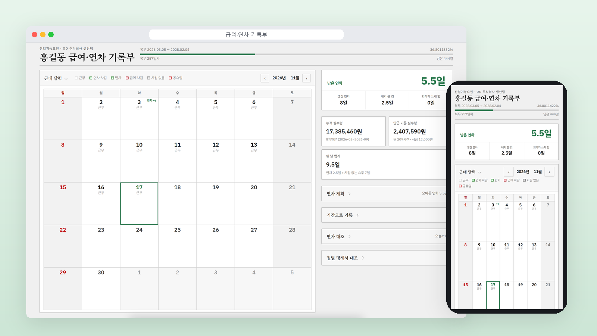
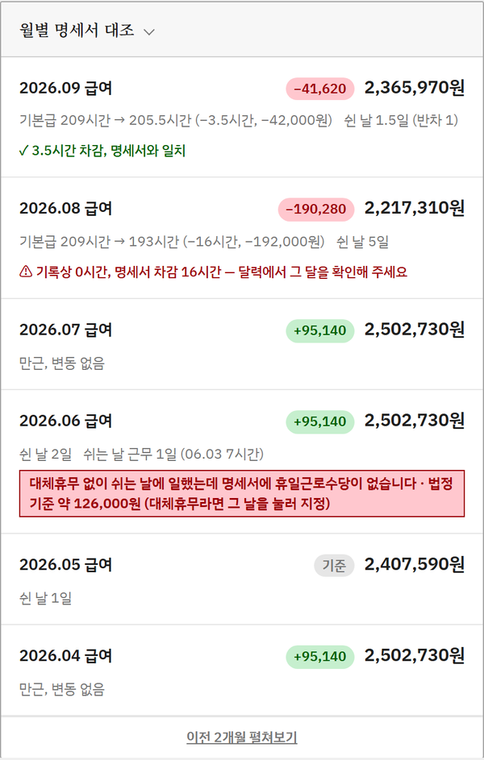
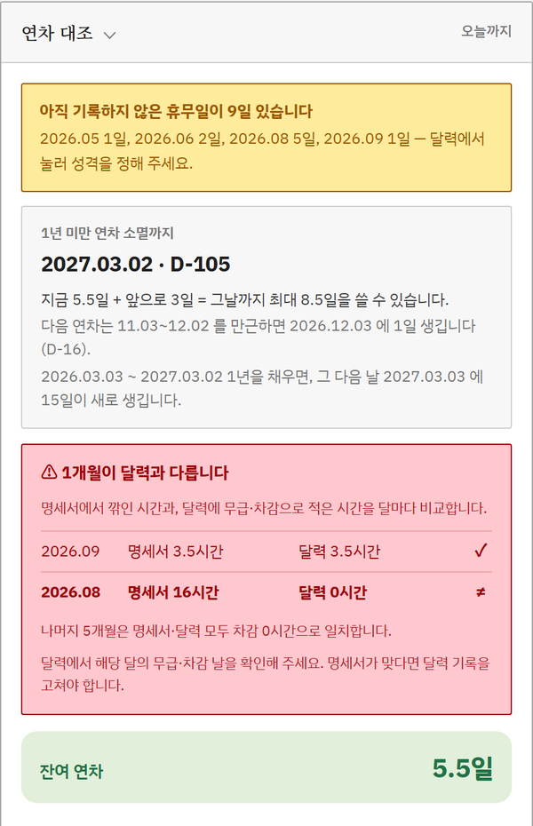
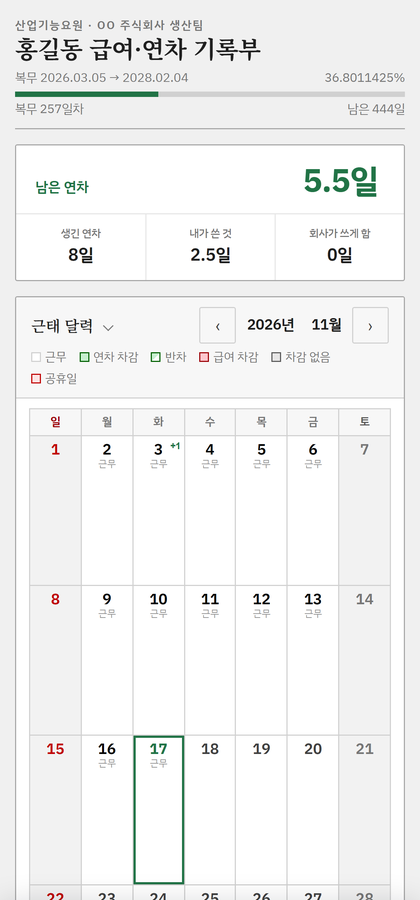
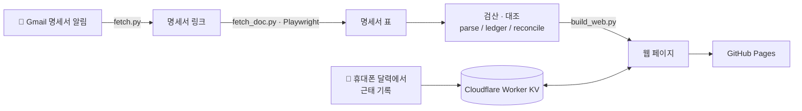

<div align="center">

# 📒 급여 연차 기록부

**급여명세서를 자동으로 모아 다시 계산하고, 직접 기록한 근태와 대조해 주는 개인용 웹 도구**

<br />


<br />



<sub>스크린샷의 이름 · 회사 · 금액은 모두 가짜 데이터입니다.</sub>

</div>

<br />

## ✨ 주요 기능

| | 기능 | 내용 |
| :-: | --- | --- |
| 📥 | **명세서 자동 수집** | Gmail 로 오는 전자 급여명세서 알림에서 링크를 찾아, 실제 브라우저(Playwright)로 열고 명세서 표를 읽어 온다. |
| 🧮 | **검산** | 지급 · 공제 합계, 고용보험 0.9%, 주민세 10%, 실지급액을 다시 계산해 명세서와 맞는지 확인한다. |
| 📅 | **근태 달력** | 쉰 날의 성격(연차 · 반차 · 무급 · 전사휴무 · 대체휴무)을 휴대폰 달력에서 직접 찍는다. |
| 🔍 | **3열 대조** | 법정 계산값 · 명세서 값 · 내가 찍은 값을 나란히 놓고, 어긋나는 달을 짚어 준다. |
| 🌴 | **연차 잔고** | 생긴 연차 · 쓴 연차 · 남은 연차와 소멸일까지 남은 날을 한눈에 보여 준다. |

<br />

## 📸 화면

<table>
  <tr>
    <td align="center" width="38%"></td>
    <td align="center" width="38%"></td>
    <td align="center" width="24%"></td>
  </tr>
  <tr>
    <td align="center"><b>월별 명세서 대조</b><br /><sub>달마다 금액이 왜 바뀌었는지, 기록과 다른 곳은 어디인지</sub></td>
    <td align="center"><b>연차 대조</b><br /><sub>남은 연차, 소멸일, 명세서와 달력이 다른 달</sub></td>
    <td align="center"><b>모바일</b><br /><sub>홈 화면에 추가해 앱처럼 사용</sub></td>
  </tr>
</table>

<br />

## 🏗️ 구조



| 영역 | 사용 기술 |
| --- | --- |
| 수집 · 검산 | Python (`src/`), Playwright, openpyxl |
| 화면 | 순수 HTML · CSS · JavaScript — 빌드 스크립트가 한 템플릿에서 두 벌을 만든다 |
| 저장 · 배포 | Cloudflare Workers + KV (근태 기록), GitHub Pages (페이지), GitHub Actions (수동 실행 수집) |

<br />

## 🔒 개인정보를 다루는 방식

이 저장소는 **공개 저장소를 전제로** 만들었다.

- 급여명세서, 근태 기록, 메일 링크, 빌드된 데이터는 커밋하지 않는다 (`.gitignore`).
- 시급 · 입사일 같은 계약 조건은 `config.json`, 비밀번호 · 암구호는 `.env` 에만 두고 둘 다 커밋하지 않는다.
- 웹 페이지는 Worker 에서 데이터를 받아오며, 암구호를 아는 요청에만 응답한다.

<br />

## 🚀 직접 돌려보기

```bash
python -m venv .venv
.venv\Scripts\activate          # macOS/Linux: source .venv/bin/activate
pip install -r requirements.txt
playwright install chromium
```

설정 파일 두 개가 필요하다 (둘 다 커밋되지 않는다).

- `config.json` — 시급, 월 소정근로시간, 입사일 등 (`config.example.json` 을 복사)
- `.env` — Gmail 앱 비밀번호, Cloudflare Worker 주소와 암구호 (`.env.example` 을 복사)

```bash
python src/fetch.py links      # Gmail 에서 명세서 메일의 링크 추출
python src/fetch_doc.py        # 링크를 브라우저로 열어 명세서 저장
python src/report.py           # 평소와 달라진 항목만 보고
python src/build_web.py        # 페이지 빌드
python src/push_data.py        # Cloudflare 로 데이터 올리기
```

> [!NOTE]
> 명세서 링크는 **3개월만 유효**해서, 한 달에 한 번은 돌려야 한다.
> Worker 설정은 [`worker/README.md`](worker/README.md) 참고.

<details>
<summary><b>페이지 두 벌</b></summary>
<br />

`src/build_web.py` 가 같은 템플릿에서 두 벌을 만든다.

| 파일 | 어디에 | 데이터 | 근태 기록 저장 |
| --- | --- | --- | --- |
| `web/index.html` | Claude 아티팩트 | 페이지 안에 포함 | 아티팩트 DB |
| `docs/index.html` | GitHub Pages | Worker 에서 받아옴 | Worker KV |

저장소가 서로 달라 한쪽에서 기록한 값은 다른 쪽에 보이지 않는다. 하나를 정해서 쓴다.

</details>

<details>
<summary><b>급여 계산 구조</b></summary>
<br />

명세서에서 역산한 계산 구조 (실제 값은 `config.json`).

- 만근 기본급 = 시급 × 월 소정근로시간
- 1일치 = 시급 × 1일 근로시간
- 연차를 그 달에 쓰지 않으면 `연차수당`으로 현금 지급되고, 쓰면 유급으로 쉰다
- 그보다 더 쉬면 초과분이 기본급에서 시간 단위로 차감된다

</details>

<br />

---

<div align="center">
<sub>기획 · 요구사항 정리 · 검증 · 배포는 직접 했고, 코드 작성에는 Claude Code 를 활용했다.</sub>
</div>
